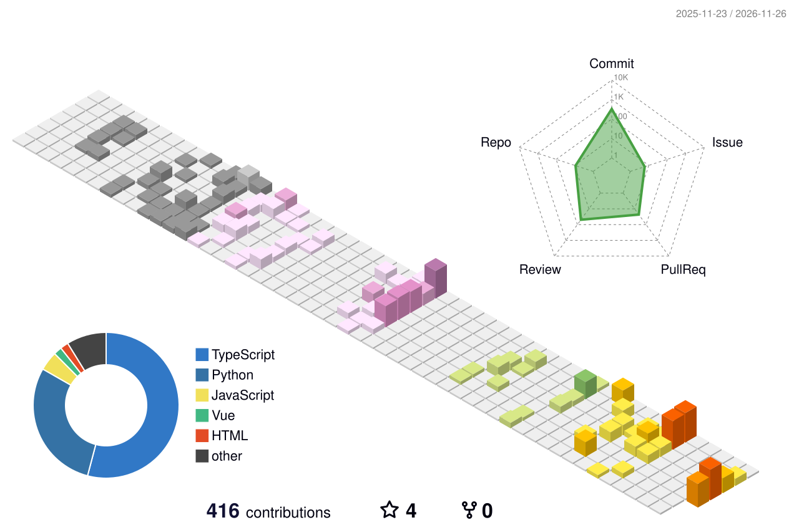

<!--
  ===== sogawa10 Profile README =====
  編集のしかた:
  - 各セクションは「■」で始まるコメントで区切ってあります。
  - プロジェクトを増やすときは「指してきた手」の表に1行足すだけでOK。
  - 技術を増やすときは skillicons の URL の i= にカンマ区切りで追加（dark と light の両方）。
    使えるID一覧: https://github.com/tandpfun/skill-icons#icons-list
  - <picture> の中は、上が「ダークモード用」、下の img が「ライトモード用」。
  - srcset の中では URL のカンマを %2C と書く（カンマは区切り文字扱いになるため）。
  - 3D草の画像は .github/workflows/profile-art.yml が毎日自動で作ります。
-->

<!-- ■ ヘッダー（ライト） -->

  

<!-- ■ ヘッダー（ダーク） -->

  <picture>
    <source media="(prefers-color-scheme: dark)" srcset="https://capsule-render.vercel.app/api?type=waving&color=0:120c06%2C50:3d2814%2C100:7a4f26&height=200&section=header&text=sogawa10&fontSize=56&fontColor=e8cfa0&fontAlignY=42&v=3">
    
  </picture>

---

<!-- ■ プロジェクト -->

## ☗ 指してきた手（Projects）

| プロジェクト | ひとこと |
|---|---|
| **[VegeTASK](https://github.com/sogawa10/hackathon)** | 勉強を「野菜を育てること」に見立てたタスク管理アプリ。タスクを毎日の小タスクに分割し、こなすと野菜が育ち、サボると枯れる。  [サイトを公開中!](https://www.vegetask.net/) |
| **[shogi_ai](https://github.com/sogawa10/shogi_ai)** | 既存エンジンを使わず、ルール処理からαβ探索まで自前実装した将棋AI。二歩・打ち歩詰め・千日手・入玉宣言法まで対応し、APIとして提供 |
| **[shogi_frontend](https://github.com/sogawa10/shogi_frontend)** | 上の将棋AIと対局できるWebサイト。外部の将棋AIのAPIを登録すれば、対局できる。 |

<!-- ■ 技術スタック（ダーク/ライトでアイコンの色が切り替わる） -->

## ☗ 持ち駒（Tech Stack）

  <b>AI / 研究</b> 
  <picture>
    <source media="(prefers-color-scheme: dark)" srcset="https://skillicons.dev/icons?i=python%2Cpytorch&theme=dark">
    
  </picture>

  <b>フロントエンド</b> 
  <picture>
    <source media="(prefers-color-scheme: dark)" srcset="https://skillicons.dev/icons?i=ts%2Cjs%2Creact%2Cvue%2Cvite%2Chtml%2Ccss&theme=dark">
    
  </picture>

  <b>バックエンド / インフラ</b> 
  <picture>
    <source media="(prefers-color-scheme: dark)" srcset="https://skillicons.dev/icons?i=go%2Cfastapi%2Cpostgres%2Cdocker%2Cnginx%2Clinux%2Cgithubactions%2Cgit&theme=dark">
    
  </picture>

<!-- ■ 3D の草（ダーク: 夜景 / ライト: 季節の色） -->

## ☗ 棋譜（Contributions）

  <picture>
    <source media="(prefers-color-scheme: dark)" srcset="./profile-3d-contrib/profile-night-rainbow.svg">
    
  </picture>

<!-- ■ ツーリング（ダーク: 夜道 / ライト: 昼の道）。絵は tools/touring.py で作り直せる -->

  <picture>
    <source media="(prefers-color-scheme: dark)" srcset="./assets/touring-night.svg">
    
  </picture>

