<!--
  ===== sogawa10 Profile README =====
  編集のしかた:
  - 各セクションは「■」で始まるコメントで区切ってあります。
  - プロジェクトを増やすときは tools/cards.py の PROJECTS に1件足して、下の Projects にカードを1枚追加する。
  - 技術を増やすときは、該当カテゴリの skillicons の URL の i= にカンマ区切りで追加（dark と light の両方）。
    使えるID一覧: https://github.com/tandpfun/skill-icons#icons-list
    skillicons に無い Slack は assets/icons/ の SVG を、直前の picture の閉じタグの直後に
    （改行やスペースを挟まず）続けて並べている。左に余白入りなので、必ず行の最後に置く。
  - <picture> の中は、上が「ダークモード用」、下の img が「ライトモード用」。
  - srcset の中では URL のカンマを %2C と書く（カンマは区切り文字扱いになるため）。
  - ヘッダーは tools/header.py、成果物カード・Stats・言語比率は tools/cards.py、
    コントリビューションのグラフは tools/contrib.py で作っている。
    cards.py と contrib.py は .github/workflows/profile-art.yml が毎日自動で実行する。
-->

<!-- ■ ヘッダー（ダーク: 夜 / ライト: 昼） -->

  <picture>
    <source media="(prefers-color-scheme: dark)" srcset="./assets/banner-night.svg">
    
  </picture>

<!-- ■ プロジェクト（カードは tools/cards.py の PROJECTS から作る。スター数などは毎日自動更新） -->

## Projects

  <a href="https://github.com/sogawa10/hackathon"><picture><source media="(prefers-color-scheme: dark)" srcset="./assets/project-hackathon-night.svg"></picture></a>
  <a href="https://www.vegetask.net/"><picture><source media="(prefers-color-scheme: dark)" srcset="./assets/site-hackathon-night.svg"></picture></a>

  <a href="https://github.com/sogawa10/shogi_ai"><picture><source media="(prefers-color-scheme: dark)" srcset="./assets/project-shogi_ai-night.svg"></picture></a>

  <a href="https://github.com/sogawa10/shogi_frontend"><picture><source media="(prefers-color-scheme: dark)" srcset="./assets/project-shogi_frontend-night.svg"></picture></a>

<!-- ■ 技術スタック（ダーク/ライトでアイコンの色が切り替わる）
  並べ方のルール: どの行も「フロントエンド → バックエンド → AI・その他」の順（Webアプリの手前から奥へ）。
  Softwares は「開発するPC → サーバーのOS → その上で動くもの（Docker → Nginx → DB）」の順。 -->

## Tech Stack

#### 💻 Programming Languages

  <picture>
    <source media="(prefers-color-scheme: dark)" srcset="https://skillicons.dev/icons?i=html%2Ccss%2Cjs%2Cts%2Cgo%2Cpython%2Cc%2Cjava%2Cmatlab&theme=dark">
    
  </picture>

#### 📚 Library & Framework

  <picture>
    <source media="(prefers-color-scheme: dark)" srcset="https://skillicons.dev/icons?i=react%2Cvue%2Cfastapi%2Cpytorch%2Copencv&theme=dark">
    
  </picture>

#### 🌐 Platforms

  <picture>
    <source media="(prefers-color-scheme: dark)" srcset="https://skillicons.dev/icons?i=nodejs%2Cgithub&theme=dark">
    
  </picture>

#### 🛠 Tools

  <picture>
    <source media="(prefers-color-scheme: dark)" srcset="https://skillicons.dev/icons?i=npm%2Cvite%2Canaconda%2Cgit%2Cgithubactions&theme=dark">
    
  </picture>

#### 💾 Softwares

  <picture>
    <source media="(prefers-color-scheme: dark)" srcset="https://skillicons.dev/icons?i=windows%2Clinux%2Cubuntu%2Cdebian%2Cdocker%2Cnginx%2Cpostgres&theme=dark">
    
  </picture>

#### 🖥 Applications

  <picture>
    <source media="(prefers-color-scheme: dark)" srcset="https://skillicons.dev/icons?i=vscode%2Cnotion%2Cdiscord&theme=dark">
    
  </picture><picture>
    <source media="(prefers-color-scheme: dark)" srcset="./assets/icons/slack-dark.svg">
    
  </picture>

<!-- ■ GitHub の数字・言語比率・コントリビューション・最近の活動（tools/cards.py と tools/contrib.py が毎日自動で作り直す） -->

## Activity

  <picture><source media="(prefers-color-scheme: dark)" srcset="./assets/stats-night.svg"></picture>
  <picture><source media="(prefers-color-scheme: dark)" srcset="./assets/langs-night.svg"></picture>

  <picture><source media="(prefers-color-scheme: dark)" srcset="./assets/contrib-night.svg"></picture>

  <picture><source media="(prefers-color-scheme: dark)" srcset="./assets/activity-night.svg"></picture>

<!-- ■ フッター: ツーリングのドット絵をカードの枠に収めたもの（tools/footer.py。元の絵は tools/touring.py） -->

  <picture><source media="(prefers-color-scheme: dark)" srcset="./assets/footer-night.svg"></picture>

