<!--
  ===== sogawa10 Profile README =====
  編集のしかた:
  - 各セクションは「■」で始まるコメントで区切ってあります。
  - プロジェクトを増やすときは tools/cards.py の PROJECTS に1件足して、下の Projects にカードを1枚追加する。
  - 技術を増やすときは tools/stack.py の STACK の該当カテゴリに1件足して python tools/stack.py を実行し、
    下の Tech Stack の alt にも名前を足す。アイコンは skill-icons のもの（ファイル名一覧: https://github.com/tandpfun/skill-icons/tree/main/icons）。
    skill-icons に無い Slack は assets/icons/ の SVG を使っている。光り方（グロー・縁取り・光沢）も stack.py で調整できる。
  - <picture> の中は、上が「ダークモード用」、下の img が「ライトモード用」。
  - ヘッダーは tools/header.py、Tech Stack のアイコンは tools/stack.py、成果物カード・Stats・言語比率は tools/cards.py、
    コントリビューションのグラフは tools/contrib.py で作っている。
    cards.py と contrib.py は .github/workflows/profile-art.yml が毎日自動で実行する。
-->

<!-- ■ ヘッダー（ダーク: 夜 / ライト: 昼） -->

  <picture>
    <source media="(prefers-color-scheme: dark)" srcset="./assets/banner-night.svg">
    
  </picture>

<!-- ■ プロジェクト（カードは tools/cards.py の PROJECTS から作る。スター数などは毎日自動更新） -->

## Projects

  <a href="https://github.com/sogawa10/hackathon"><picture><source media="(prefers-color-scheme: dark)" srcset="./assets/project-hackathon-night.svg"></picture></a>
  <a href="https://www.vegetask.net/"><picture><source media="(prefers-color-scheme: dark)" srcset="./assets/site-hackathon-night.svg"></picture></a>

  <a href="https://github.com/sogawa10/shogi_ai"><picture><source media="(prefers-color-scheme: dark)" srcset="./assets/project-shogi_ai-night.svg"></picture></a>

  <a href="https://github.com/sogawa10/shogi_frontend"><picture><source media="(prefers-color-scheme: dark)" srcset="./assets/project-shogi_frontend-night.svg"></picture></a>

<!-- ■ 技術スタック（tools/stack.py が作る光るアイコン。ダーク/ライトで色と光り方が切り替わる）
  並べ方のルール: どの行も「フロントエンド → バックエンド → AI・その他」の順（Webアプリの手前から奥へ）。
  Softwares は「開発するPC → サーバーのOS → その上で動くもの（Docker → Nginx → DB）」の順。 -->

## Tech Stack

#### 💻 Programming Languages

  <picture><source media="(prefers-color-scheme: dark)" srcset="./assets/stack-languages-night.svg"></picture>

#### 📚 Library & Framework

  <picture><source media="(prefers-color-scheme: dark)" srcset="./assets/stack-frameworks-night.svg"></picture>

#### 🌐 Platforms

  <picture><source media="(prefers-color-scheme: dark)" srcset="./assets/stack-platforms-night.svg"></picture>

#### 🛠 Tools

  <picture><source media="(prefers-color-scheme: dark)" srcset="./assets/stack-tools-night.svg"></picture>

#### 💾 Softwares

  <picture><source media="(prefers-color-scheme: dark)" srcset="./assets/stack-softwares-night.svg"></picture>

#### 🖥 Applications

  <picture><source media="(prefers-color-scheme: dark)" srcset="./assets/stack-apps-night.svg"></picture>

<!-- ■ GitHub の数字・言語比率・コントリビューション・最近の活動（tools/cards.py と tools/contrib.py が毎日自動で作り直す） -->

## Activity

  <picture><source media="(prefers-color-scheme: dark)" srcset="./assets/stats-night.svg"></picture>
  <picture><source media="(prefers-color-scheme: dark)" srcset="./assets/langs-night.svg"></picture>

  <picture><source media="(prefers-color-scheme: dark)" srcset="./assets/contrib-night.svg"></picture>

<!-- ■ フッター: ツーリングのドット絵をカードの枠に収めたもの（tools/footer.py。元の絵は tools/touring.py） -->

  <picture><source media="(prefers-color-scheme: dark)" srcset="./assets/footer-night.svg"></picture>

